# Diagrama Entidade-Relacionamento — SchoolManagement

> **Nota:** Nomes em português (após migrações de renomeação).

---

## 1. NÚCLEO ACADÉMICO

```mermaid
erDiagram
    %% ==================== ENTIDADES PRINCIPAIS ====================
    alunos {
        bigint id PK
        string name
        string nProcess
        string nBi UK
        string father
        string mother
        string contact
        string contactAlter
        string email
        string image "nullable"
        date dateBirth
        string schoolyear
        timestamp created_at
        timestamp updated_at
        timestamp deleted_at "softDeletes"
    }

    docentes {
        bigint id PK
        string nBi
        string name
        string email UK
        string contact
        string contactAlter
        string literary
        string specialty
        timestamp created_at
        timestamp updated_at
        timestamp deleted_at "softDeletes"
    }

    usuarios {
        bigint id PK
        string name
        string email UK
        timestamp email_verified_at "nullable"
        string password
        remember_token
        string image "nullable"
        timestamp created_at
        timestamp updated_at
        timestamp deleted_at "softDeletes"
    }

    cursos {
        bigint id PK
        string name
        string details
        string duration
        timestamp created_at
        timestamp updated_at
        timestamp deleted_at "softDeletes"
    }

    niveis {
        bigint id PK
        string name
        string details
        timestamp created_at
        timestamp updated_at
        timestamp deleted_at "softDeletes"
    }

    turmas {
        bigint id PK
        string name
        string details
        timestamp created_at
        timestamp updated_at
        timestamp deleted_at "softDeletes"
    }

    anos_lectivos {
        bigint id PK
        string name
        string details
        timestamp created_at
        timestamp updated_at
        timestamp deleted_at "softDeletes"
    }
```

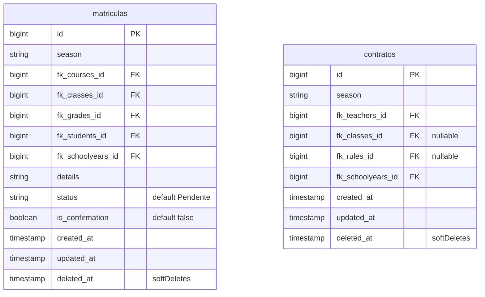

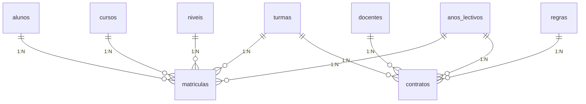

---

## 2. EXAMES, GRUPOS & DISCIPLINAS

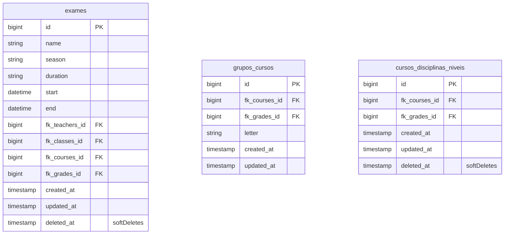

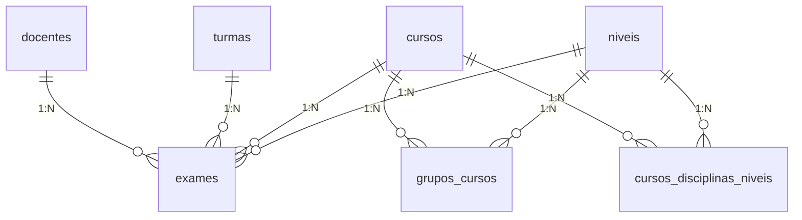

---

## 3. PAGAMENTOS

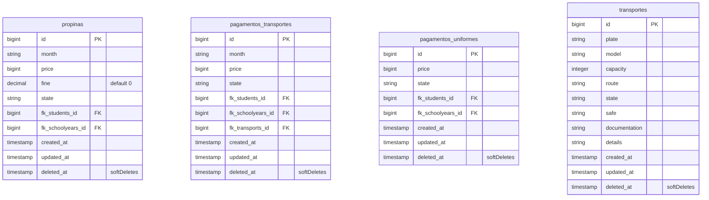

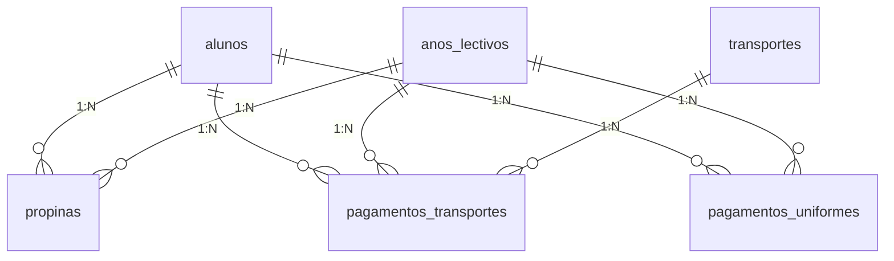

---

## 4. SEGURANÇA & COMUNICAÇÃO

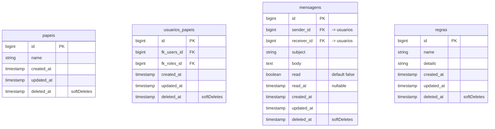

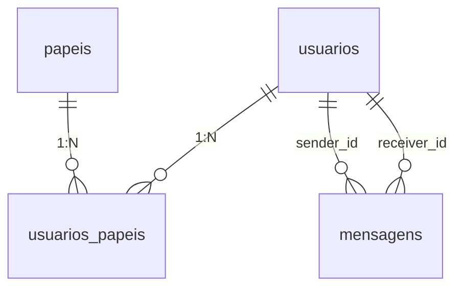

---

## 5. PIVOTS — DOCENTES

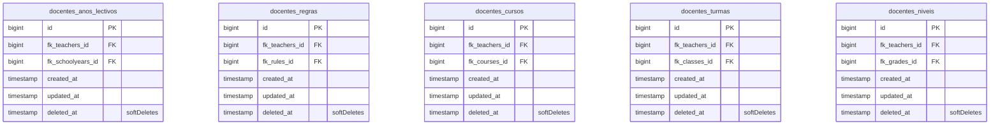

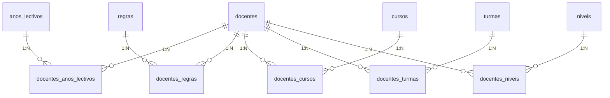

---

## 6. SISTEMA (Laravel / Logs)

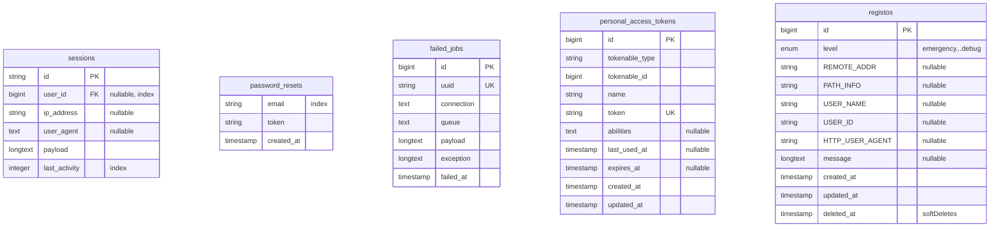

---

## MAPA COMPLETO DE RELACIONAMENTOS

```
┌────────────────────────────────────────────────────────────────────┐
│                        DIAGRAMA CONCEITUAL                        │
├────────────────────────────────────────────────────────────────────┤
│                                                                    │
│  ┌──────────┐    ┌──────────────┐    ┌────────────────────┐      │
│  │ alunos   │───▷│  matriculas  │◁───│ cursos             │      │
│  └──────────┘    │              │    └────────────────────┘      │
│                  │  (matricula  │    ┌────────────────────┐      │
│  ┌──────────┐    │   N:N)      │◁───│ turmas             │      │
│  │ docentes │───▷│              │    └────────────────────┘      │
│  └──────────┘    └──────────────┘    ┌────────────────────┐      │
│       │                             │ niveis             │      │
│       │         ┌──────────────┐    └────────────────────┘      │
│       ├────────▷│  contratos   │◁─── anos_lectivos              │
│       │         └──────────────┘                                │
│       │         ┌──────────────┐    ┌────────────────────┐      │
│       ├────────▷│   exames     │◁───│ cursos, turmas,    │      │
│       │         └──────────────┘    │ niveis             │      │
│       │                             └────────────────────┘      │
│       ├──────────┐  ┌──────────────────────────────────┐        │
│       │          ├─▷│ docentes_anos_lectivos (pivot)   │        │
│       │          ├─▷│ docentes_regras (pivot)          │        │
│       │          ├─▷│ docentes_cursos (pivot)          │        │
│       │          ├─▷│ docentes_turmas (pivot)          │        │
│       │          └─▷│ docentes_niveis (pivot)          │        │
│       │             └──────────────────────────────────┘        │
│       │                                                         │
│       └──────────┐                                              │
│                  ▼                                              │
│  ┌──────────────────────────────────────────────────────┐       │
│  │           PAGAMENTOS (por aluno + ano lectivo)       │       │
│  │  ┌──────────┐  ┌──────────────────┐  ┌────────────┐ │       │
│  │  │ propinas │  │pagamentos_transp │  │pagt_uniformes│ │       │
│  │  └──────────┘  └──────────────────┘  └────────────┘ │       │
│  └──────────────────────────────────────────────────────┘       │
│                                                                    │
│  ┌─────────────────────────────────────────────┐                 │
│  │  USUÁRIOS                                   │                 │
│  │  usuarios──usuarios_papeis──papeis          │                 │
│  │  usuarios──mensagens (sender/receiver)      │                 │
│  └─────────────────────────────────────────────┘                 │
│                                                                    │
│  ┌─────────────────────────────────────────────┐                 │
│  │  SISTEMA: sessions, password_resets,       │                 │
│  │            failed_jobs, personal_access_    │                 │
│  │            tokens, registos                 │                 │
│  └─────────────────────────────────────────────┘                 │
└────────────────────────────────────────────────────────────────────┘
```

---

## TABELAS REMOVIDAS (histórico)

| Nome Original | Nome PT | Motivo |
|--------------|---------|--------|
| `bedrooms` | `quartos` | Drop |
| `bedroom_students` | `alunos_quartos` | Drop |
| `residences` | `residencias` | Drop |
| `professores` | — | Drop (tabela duplicada) |
| `departments` | `departamentos` | Drop |
| `subjects` | `disciplinas` | Drop (e colunas FK removidas) |
| `teachers_subjects` | `docentes_disciplinas` | Drop |
